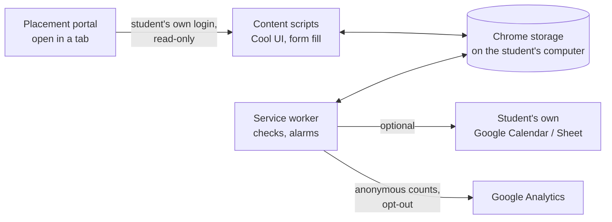

# Placement Tracker

A Chrome extension I built for my MBA batch during placement season. It turns a cluttered placement portal into one clear view: what closes soon, what each application costs, and what to do next.

**~70 students use it every week.** [Chrome Web Store](https://chromewebstore.google.com/detail/candijbnhbmpjcjdfglbeeapaedllahb) · [Privacy policy](https://thebettercampus.netlify.app/tracker-privacy/)

> Independent student project. Not made, run or endorsed by ISB or its placement team.

I'm not a software engineer. I built it the new way: by directing AI coding agents, one release at a time.

## The problem
Every placement season, hundreds of MBA students work through the same portal: hundreds of roles, scattered deadlines, a limited number of applications each, and the same forms filled again and again. Good candidates missed roles they wanted, not because they weren't good enough, but because the system was hard to use.

## What it does
- **One clear view ("Cool UI").** A student's own portal data as one list of every job, in tables by when it closes (24 hours, 3 days, later), sortable, with eligibility, cut-offs and what each application costs in counters. Switch back to the portal's own pages any time.
- **Counters and applications.** Applications left per cluster, when each one comes back, every application's next step and deadline up front, and the shortlist count at each round.
- **Pre-filled recruiter forms.** The repetitive fields come ready from the student's own profile and earlier answers. The tracker never submits: the student always reviews and presses Submit.
- **Deadlines in your own calendar (optional).** Deadlines, next steps and shortlist dates go to a calendar in the student's own Google account, and reach their phone.
- **Upcoming, Q&A and a Google Sheet.** The next two weeks at a glance, answers from the placement team grouped by firm, and a Sheet of every job in the student's own Drive.

## Private by design
The tracker reads the student's own portal data with their own login, inside their own browser. Nothing is sent to any server of mine. Deadlines go only to the student's own Google Calendar and Sheet, if they turn those on. Anonymous usage counts (which features are used, never portal data or anything typed; opt-out in the extension) go to Google Analytics so I can see what helps. Full details: [privacy policy](https://thebettercampus.netlify.app/tracker-privacy/).

## How it works

- **Manifest V3** extension, plain JavaScript, no framework and no build step.
- **Content scripts** draw the cleaner view on top of the portal's pages and fill recruiter forms.
- **A service worker** keeps the data fresh: it reads the portal while it's open in a tab and, when no portal tab is open, every 2 hours through one background tab.
- **Google sign-in** with the narrowest scopes: only the calendar the tracker creates, and only the one Sheet file it makes.

## Results (10–16 Nov 2026)
- ~70 students used it every week (~65 a day), 81 store users
- 140 recruiter forms pre-filled for 37 students
- 1,066 CGPA questions handled for 62 students
- Dozens of releases, shipped from student feedback

## How I built it
Talk to users, ship fast, measure everything, fix what breaks. Each release started from a manual step students hated, automated it, and checked in the usage counts that it was used. When one update upset students, it was rolled back the same day and the fix shipped the next.

## What's next
Agents that screen jobs, plan applications and draft follow-ups, with the student approving anything before it's sent.

## About this repository
- This is the code of version **2.0.4**, shared as a showcase. Code comments and the test suite (14 browser test suites and unit tests on a fake portal) are kept in the private working repository.
- The Google Analytics IDs and the Google OAuth client ID are placeholders (`G-XXXXXXXXXX`, `YOUR_MP_API_SECRET`, `YOUR_CLIENT_ID`). Without a client ID the extension runs without the calendar.
- To try it: Chrome → `chrome://extensions` → Developer mode → **Load unpacked** → the `extension` folder. It only does something on the placement portal it was built for.

## Licence
Source-available under the [PolyForm Noncommercial License 1.0.0](LICENSE.md): free to read, learn from and use for non-commercial purposes; not for commercial use.

---
Built by **Aditya** · [LinkedIn](https://www.linkedin.com/in/withaditya/)
